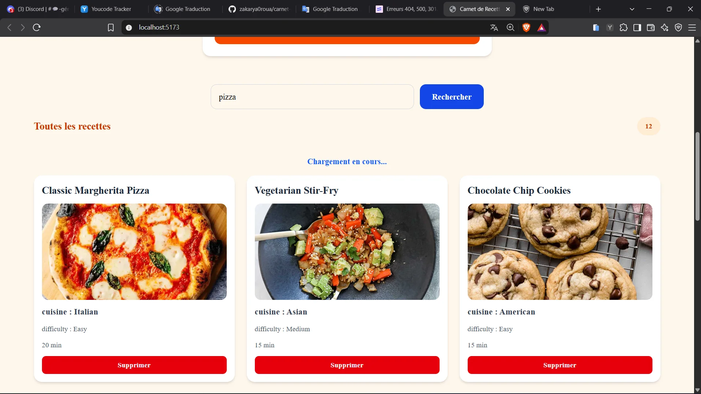
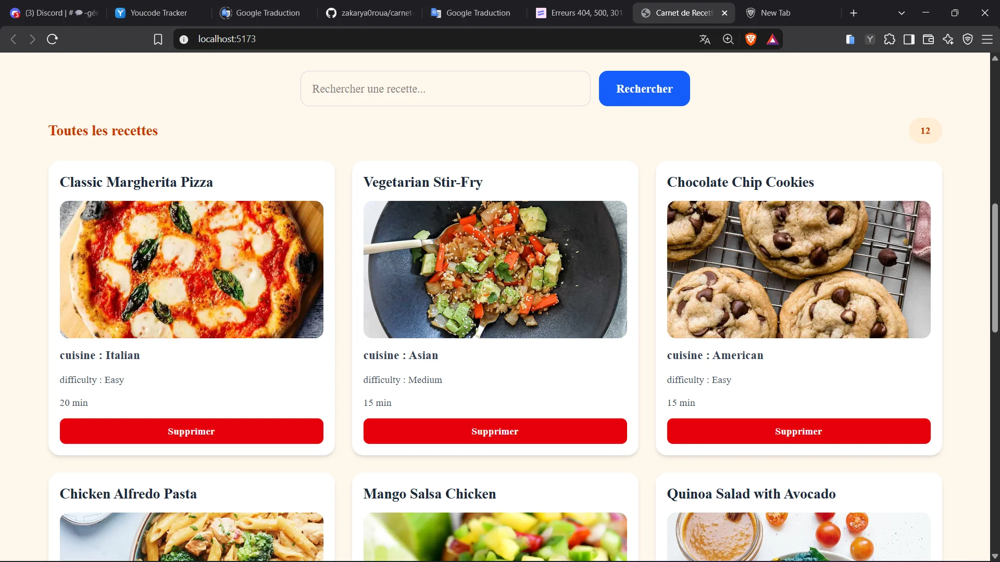
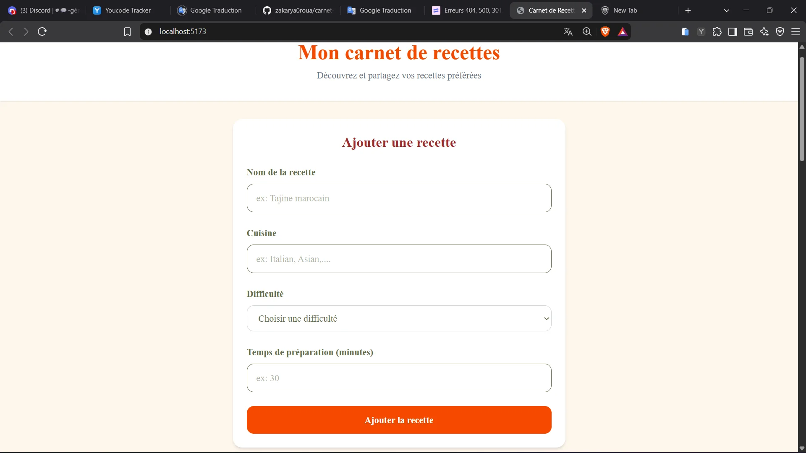
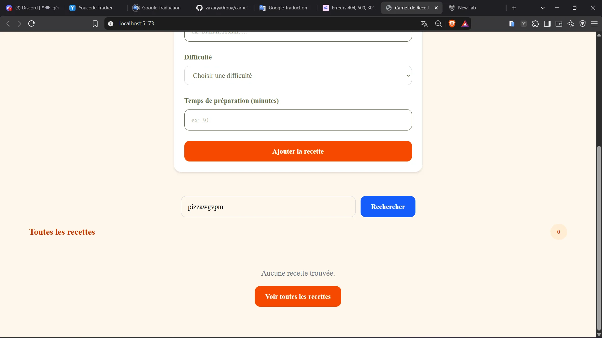

# 🍳 Mon carnet de recettes

Application web pour le **club cuisine de YouCode** : voir les recettes, en chercher une, en ajouter une et en supprimer une.
Les données viennent de l'API publique [DummyJSON Recipes](https://dummyjson.com/docs/recipes) (sans clé).

- **GitHub** : https://github.com/zakarya0roua/carnet-recettes
- **Application en ligne** : https://zakarya0roua.github.io/carnet-recettes/
- **Kanban** : https://github.com/users/zakarya0roua/projects/7

## Technologies

- HTML, Tailwind CSS, JavaScript natif (sans framework)
- **Axios** pour toutes les requêtes (aucun `fetch` dans le projet)
- Vite (serveur de développement)

## Fonctionnalités

| User story | Ce que fait l'application |
|---|---|
| US-01 | Affiche les recettes (photo, nom, cuisine, difficulté, temps) et leur nombre |
| US-02 | Cherche une recette par mot-clé, avec le message « Aucune recette trouvée » et un bouton pour tout revoir |
| US-03 | Ajoute une recette avec un formulaire vérifié avant l'envoi |
| US-04 | Supprime une recette après confirmation |
| US-05 | Affiche un chargement, des erreurs claires et un bouton Réessayer |

## Structure du projet

| Fichier | Rôle |
|---|---|
| `index.html` | Structure de la page (formulaire, recherche, liste, messages) |
| `src/api.js` | Instance Axios (`baseURL` + `timeout`) et appels API : `getRecipes`, `searchRecipes`, `addRecipe`, `deleteRecipe` |
| `src/validation.js` | Vérification du formulaire avant l'envoi |
| `src/affichage.js` | Affichage des cartes et du nombre de recettes |
| `src/main.js` | Point d'entrée : événements, chargement, erreurs, lien entre API, validation et affichage |
| `vite.config.js` | Configuration de Vite (base pour GitHub Pages) |

## Tableau des requêtes

Base URL : `https://dummyjson.com`

| Action | Méthode | URL | Données envoyées | Réponse |
|---|---|---|---|---|
| Lister les recettes | `GET` | `/recipes?limit=12` | aucune | `{ recipes: [...], total, skip, limit }` |
| Chercher une recette | `GET` | `/recipes/search?q=pizza` | paramètre `q` | `{ recipes: [...], total, ... }` (liste vide si rien trouvé) |
| Ajouter une recette | `POST` | `/recipes/add` | JSON : `name`, `cuisine`, `difficulty`, `prepTimeMinutes` | La recette créée avec un nouvel `id` |
| Supprimer une recette | `DELETE` | `/recipes/{id}` | aucune (l'id est dans l'URL) | La recette avec `isDeleted: true` |

## Validation du formulaire

| Champ | Règle |
|---|---|
| Nom | entre 3 et 60 caractères |
| Cuisine | obligatoire |
| Difficulté | `Easy`, `Medium` ou `Hard` |
| Temps | nombre entre 1 et 300 minutes |

Si un champ est invalide, un message s'affiche sous le champ et **aucune requête POST n'est envoyée**.

## Gestion des erreurs

| Cas | Message affiché |
|---|---|
| Pas de réponse (réseau, timeout) | Serveur injoignable |
| Erreur 404 | Recette introuvable (404) |
| Erreur 500 | Erreur du serveur (500) |
| Liste vide | Aucune recette trouvée |

Le bouton **Réessayer** recharge la liste des recettes.

## Captures d'écran

**Chargement**



**Liste des recettes**



**Formulaire d'ajout**



**Aucun résultat**



**Erreur**


## ⚠️ Limite de l'API de démonstration

DummyJSON répond comme un vrai serveur, mais **n'enregistre rien**.
Un ajout ou une suppression renvoie une réponse correcte, mais si on recharge la page, la liste d'origine (12 recettes) revient.
L'application met donc à jour l'affichage avec la réponse du serveur, sans sauvegarde réelle.

## Lancer le projet en local

```bash
git clone https://github.com/zakarya0roua/carnet-recettes.git
cd carnet-recettes
npm install
npm run dev
```

Puis ouvrir http://localhost:5173.

## Scénarios de test manuels

| # | Scénario | Résultat attendu |
|---|---|---|
| 1 | Ouvrir la page | Chargement, puis 12 cartes et le nombre « 12 » |
| 2 | Chercher « pizza » | Les recettes correspondantes s'affichent |
| 3 | Chercher « pizzawgvpm » | « Aucune recette trouvée » + bouton « Voir toutes les recettes » |
| 4 | Envoyer le formulaire vide | Messages sous les champs, aucun POST dans l'onglet Network |
| 5 | Nom de 2 caractères, ou temps de 0 ou 301 | Message d'erreur sur le champ, aucun POST |
| 6 | Ajouter une recette valide | Bouton désactivé pendant l'envoi, nouvelle carte en premier, message de succès |
| 7 | Cliquer sur « Supprimer », puis annuler | Aucune requête envoyée |
| 8 | Cliquer sur « Supprimer », puis confirmer | `DELETE /recipes/{id}`, carte retirée, message de confirmation |
| 9 | Couper le réseau puis recharger | « Serveur injoignable » + bouton Réessayer |