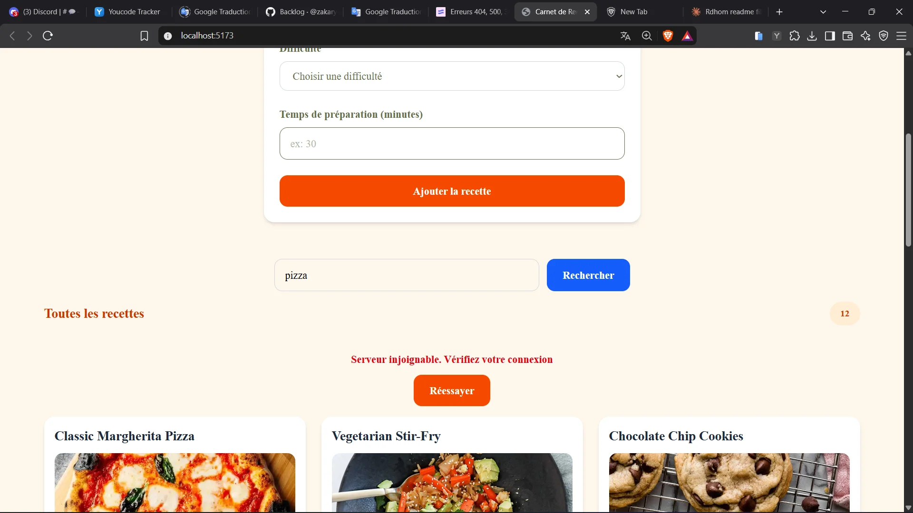

# 🍳 Mon carnet de recettes

Application web pour le **club cuisine de YouCode** : consulter les recettes, en chercher une, en proposer une nouvelle et retirer celles qui ne servent plus. Les données viennent de l'API publique [DummyJSON Recipes](https://dummyjson.com/docs/recipes) (sans clé).

- **Dépôt GitHub** : https://github.com/zakarya0roua/carnet-recettes
- **Application en ligne (GitHub Pages)** : https://zakarya0roua.github.io/carnet-recettes/
- **Kanban** : https://github.com/users/zakarya0roua/projects/7

## Technologies

- HTML, Tailwind CSS, JavaScript natif (sans framework)
- **Axios** pour toutes les requêtes (aucun `fetch` dans le projet)
- Vite (serveur de développement, `localhost:5173`)

## Fonctionnalités

| User story | Fonctionnalité |
|---|---|
| US-01 | Afficher les recettes (cartes avec photo, nom, cuisine, difficulté, temps) et leur nombre |
| US-02 | Rechercher une recette par mot-clé, avec message « Aucune recette trouvée » et bouton « Voir toutes les recettes » |
| US-03 | Ajouter une recette via un formulaire validé (nom 3 à 60 caractères, cuisine, difficulté, temps de 1 à 300 min) |
| US-04 | Supprimer une recette après confirmation |
| US-05 | Chargement, erreurs claires (serveur injoignable, 404, 500) et bouton Réessayer |

## Structure du projet

| Fichier | Rôle |
|---|---|
| `index.html` | Structure de la page (formulaire, recherche, liste, messages) |
| `src/api.js` | Instance Axios (`axios.create` avec `baseURL` et `timeout`) et fonctions d'appel : `getRecipes`, `searchRecipes`, `addRecipe`, `deleteRecipe` |
| `src/validation.js` | Validation du formulaire avant envoi (aucun POST si une erreur existe) |
| `src/affichage.js` | Affichage : cartes, compteur, chargement, messages d'erreur, « aucun résultat », succès |
| `src/main.js` | Point d'entrée : écouteurs d'événements, relie API, validation et affichage |

## Tableau des requêtes

Base URL : `https://dummyjson.com`

| Action | Méthode | URL | Données envoyées | Réponse |
|---|---|---|---|---|
| Lister les recettes | `GET` | `/recipes` | aucune | `{ recipes: [...], total, skip, limit }` |
| Chercher une recette | `GET` | `/recipes/search?q=pizza` | paramètre `q` | `{ recipes: [...], total, ... }` (liste vide si rien) |
| Ajouter une recette | `POST` | `/recipes/add` | JSON : `name`, `cuisine`, `difficulty`, `prepTimeMinutes` | La recette créée avec un nouvel `id` |
| Supprimer une recette | `DELETE` | `/recipes/{id}` | aucune (id dans l'URL) | La recette avec `isDeleted: true` et `deletedOn` |

## Gestion des erreurs

| Cas | Message affiché |
|---|---|
| Pas de réponse (réseau, timeout) | Serveur injoignable |
| 404 | Recette introuvable |
| 500 | Erreur du serveur |
| Liste vide | Aucune recette trouvée |
| Ajout / suppression en échec | Même messages (injoignable, 404, 500), affichés en rouge |

Un bouton **Réessayer** relance la dernière requête (liste ou recherche). Timeout Axios : 8 secondes.

## Captures d'écran

**Formulaire d'ajout**


**Liste des recettes (12)**


**Chargement**


**Aucun résultat**


**Erreur**



## ⚠️ Limite de l'API de démonstration

DummyJSON répond comme un vrai serveur, mais **n'enregistre rien**. Un ajout ou une suppression renvoie une réponse correcte, mais au rechargement de la page la liste d'origine (12 recettes) revient. L'application met donc à jour l'affichage à partir de la réponse du serveur, sans persistance réelle.

Conséquence : une recette ajoutée reçoit un `id` côté serveur mais n'existe pas vraiment ; la supprimer renvoie donc une erreur **404** (message « Recette introuvable (404) » affiché en rouge). Les recettes ajoutées n'ont pas de photo (un bloc « Pas d'image » est affiché).

## Lancer le projet en local

```bash
git clone https://github.com/zakarya0roua/carnet-recettes.git
cd carnet-recettes
npm install
npm run dev
```

Puis ouvrir http://localhost:5173/carnet-recettes/ (le `base` de Vite est `/carnet-recettes/`).

## Scénarios de test manuels

| # | Scénario | Résultat attendu |
|---|---|---|
| 1 | Ouvrir la page | Chargement puis 12 cartes et compteur « 12 » |
| 2 | Chercher « pizza » | Recettes correspondantes affichées |
| 3 | Chercher « pizzawgvpm » | « Aucune recette trouvée » + bouton « Voir toutes les recettes » |
| 4 | Soumettre le formulaire vide | Messages sous chaque champ invalide, aucun POST dans l'onglet Network |
| 5 | Nom de 2 caractères ou temps de 0 / 301 | Message d'erreur sur le champ, aucun POST |
| 6 | Ajouter une recette valide | Bouton désactivé pendant l'envoi, nouvelle carte en premier, message de succès |
| 7 | Cliquer sur « Supprimer » puis annuler | Aucune requête envoyée |
| 8 | Cliquer sur « Supprimer » puis confirmer | `DELETE /recipes/{id}`, carte retirée, message de confirmation |
| 9 | Couper le réseau puis recharger | Message « serveur injoignable » + bouton Réessayer |